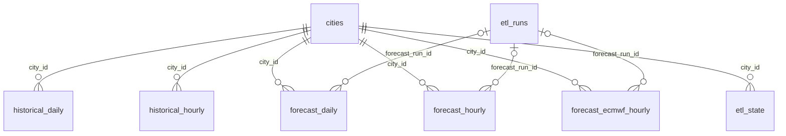

# Data Dictionary — Weather Analytics & Stormy

**Словарь данных PostgreSQL**

Документ описывает структуру базы данных проекта Weather Analytics & Stormy: таблицы, поля, типы данных, связи, ограничения целостности и правила интерпретации метеорологических показателей.

**СУБД:** PostgreSQL 16  
**Источники данных:** Open-Meteo Historical Weather API, Forecast API, ECMWF API  
**Определение схемы:** `sql/migrations/001_initial_schema.sql`  
**ORM-модели:** `src/weather_analytics/db/models.py`  
**Управление версиями схемы:** Alembic

## 1. Общая структура базы данных

База данных содержит восемь таблиц.

| Таблица | Назначение | Первичный ключ |
|---|---|---|
| `cities` | Справочник городов | `city_id` |
| `historical_daily` | Суточные исторические показатели | `city_id`, `weather_date` |
| `historical_hourly` | Почасовые исторические показатели | `city_id`, `weather_time` |
| `forecast_daily` | Суточные прогнозы | `city_id`, `forecast_date`, `fetched_at` |
| `forecast_hourly` | Почасовые прогнозы | `city_id`, `forecast_time`, `fetched_at` |
| `forecast_ecmwf_hourly` | Дополнительный прогноз ECMWF | `city_id`, `forecast_time`, `fetched_at` |
| `etl_runs` | Журнал запусков ETL | `run_id` |
| `etl_state` | Состояние исторической загрузки | `pipeline`, `city_id` |

### 1.1. Логическая модель



Основной справочник — `cities`. Все погодные таблицы связаны с ним внешним ключом `city_id`.

Исторические данные хранятся отдельно от прогнозов. Для прогнозов сохраняется время получения данных `fetched_at`, поэтому разные версии прогноза для одного города и периода могут существовать одновременно.

Таблицы `etl_runs` и `etl_state` обслуживают процесс загрузки данных и не содержат непосредственно метеорологических измерений.

## 2. Общие правила хранения данных

### 2.1. Типы данных

| Тип PostgreSQL | Использование |
|---|---|
| `INTEGER` | Идентификаторы городов, количество загруженных строк |
| `BIGINT` | Идентификаторы запусков ETL |
| `SMALLINT` | Коды погодных явлений и отдельные целочисленные показатели |
| `REAL` | Метеорологические показатели с плавающей точкой |
| `DOUBLE PRECISION` | Географические координаты |
| `VARCHAR` | Наименования, часовые пояса, статусы и типы процессов |
| `TEXT` | Сообщения об ошибках |
| `DATE` | Календарная дата |
| `TIMESTAMPTZ` | Временные отметки с учётом часового пояса |
| `BOOLEAN` | Логические признаки |

### 2.2. Время и часовые пояса

Для суточных данных используются поля `weather_date` и `forecast_date` типа `DATE`.

Для почасовых данных используются `weather_time` и `forecast_time` типа `TIMESTAMPTZ`.

Время получения версии прогноза хранится в `fetched_at`. Время загрузки исторических записей — в `loaded_at`.

Часовой пояс города хранится в `cities.timezone`. При подготовке данных для пользовательских интерфейсов временные отметки преобразуются в местное время выбранного города.

Тип `TIMESTAMPTZ` в PostgreSQL представляет момент времени; он не сохраняет исходное текстовое обозначение часового пояса.

### 2.3. Отсутствующие значения

Большинство метеорологических полей допускает `NULL`.

`NULL` означает отсутствие сохранённого значения и не должен автоматически интерпретироваться как ноль.

Примеры:

- `precipitation = 0` — сохранено нулевое количество осадков;
- `precipitation IS NULL` — значение отсутствует;
- `humidity IS NULL` — влажность не определена в сохранённых данных;
- `wind_gusts IS NULL` — значение порывов ветра отсутствует.

При расчёте средних, сумм и максимумов необходимо учитывать пропущенные значения и фактическую полноту наблюдений.

### 2.4. Единицы измерения

Основные единицы, используемые проектом:

| Показатель | Единица |
|---|---|
| Температура | °C |
| Скорость ветра | км/ч |
| Направление ветра | градусы |
| Осадки | мм |
| Влажность и облачность | % |
| Атмосферное давление в данных API | гПа |
| Продолжительность | секунды или часы — в зависимости от показателя |
| Видимость | м |
| Солнечная радиация | Вт/м² или МДж/м² — в зависимости от показателя |
| УФ-индекс | безразмерный индекс |

Для отображения в дашборде отдельные показатели преобразуются, например атмосферное давление из гПа в мм рт. ст., а видимость из метров в километры.

### 2.5. Происхождение показателей и единицы измерения

Названия метеорологических показателей определены в
`src/weather_analytics/api/constants.py`.

Соответствие полей Open-Meteo и столбцов PostgreSQL
задаётся в `src/weather_analytics/etl/field_mappings.py`.

Преобразование ответов API в записи базы данных выполняет
`WeatherTransformer` из модуля `etl/transformer.py`.

В запросах ETL не задаются параметры изменения стандартных
единиц измерения Open-Meteo. Числовые метеорологические
показатели сохраняются без пересчёта единиц.

Исключения составляют преобразования формата данных:
- Unix timestamp преобразуется в `datetime` с часовым поясом UTC;
- время восхода и заката интерпретируется в часовом поясе города;
- признак `is_day` преобразуется из `0`/`1` в `False`/`True`;
- отсутствующие необязательные показатели сохраняются как `NULL`.

Единицы измерения в словаре соответствуют стандартным единицам
Open-Meteo для запрашиваемых показателей. Для специализированных
полей ECMWF доступность значений зависит от модели и источника.

Преобразования единиц для отображения в дашборде не изменяют
исходные значения, сохранённые в PostgreSQL.

## 3. Таблица `cities`

Справочник географических объектов, для которых загружаются исторические и прогнозные данные.

| Поле | Тип | Ограничения | Описание |
|---|---|---|---|
| `city_id` | `INTEGER` | PK, IDENTITY | Уникальный идентификатор города |
| `name` | `VARCHAR(150)` | NOT NULL | Название города |
| `country` | `VARCHAR(150)` | NOT NULL | Страна |
| `latitude` | `DOUBLE PRECISION` | NOT NULL, CHECK | Широта |
| `longitude` | `DOUBLE PRECISION` | NOT NULL, CHECK | Долгота |
| `timezone` | `VARCHAR(100)` | NOT NULL | Часовой пояс |
| `is_active` | `BOOLEAN` | NOT NULL, DEFAULT TRUE | Признак активности города |

**Ограничения:**

- `PRIMARY KEY (city_id)`;
- `UNIQUE (name, country)`;
- `latitude BETWEEN -90 AND 90`;
- `longitude BETWEEN -180 AND 180`.

**Связи:** `city_id` используется во всех погодных таблицах и в `etl_state`.

Координаты используются при обращении к Open-Meteo API. Часовой пояс необходим для корректного отображения дат и времени.

## 4. Таблица `historical_daily`

**Назначение:** хранение суточных исторических погодных показателей.

**Источник:** Open-Meteo Historical Weather API.

**Первичный ключ:** `(city_id, weather_date)`.

Одна запись соответствует одному городу и одной календарной дате.

### 4.1. Идентификация и время

| Поле | Тип | Описание |
|---|---|---|
| `city_id` | `INTEGER` | FK → `cities.city_id` |
| `weather_date` | `DATE` | Дата погодных данных |
| `weather_code` | `SMALLINT` | Код погодного явления WMO |
| `loaded_at` | `TIMESTAMPTZ` | Время загрузки, по умолчанию `NOW()` |

### 4.2. Температура

| Поле | Тип | Единица | Описание |
|---|---|---|---|
| `temperature_mean` | `REAL` | °C | Средняя температура воздуха |
| `temperature_min` | `REAL` | °C | Минимальная температура |
| `temperature_max` | `REAL` | °C | Максимальная температура |
| `apparent_temperature_mean` | `REAL` | °C | Средняя ощущаемая температура |
| `apparent_temperature_min` | `REAL` | °C | Минимальная ощущаемая температура |
| `apparent_temperature_max` | `REAL` | °C | Максимальная ощущаемая температура |

### 4.3. Солнце и продолжительность дня

| Поле | Тип | Единица | Описание |
|---|---|---|---|
| `sunrise` | `TIMESTAMPTZ` | дата/время | Восход Солнца |
| `sunset` | `TIMESTAMPTZ` | дата/время | Закат Солнца |
| `daylight_duration` | `REAL` | с | Продолжительность светового дня |
| `sunshine_duration` | `REAL` | с | Продолжительность солнечного сияния |

### 4.4. Осадки

| Поле | Тип | Единица | Описание |
|---|---|---|---|
| `precipitation` | `REAL` | мм | Суммарные осадки |
| `rain_sum` | `REAL` | мм | Количество дождевых осадков |
| `snowfall_sum` | `REAL` | см | Суммарный снегопад |
| `precipitation_hours` | `REAL` | ч | Количество часов с осадками |

### 4.5. Ветер

| Поле | Тип | Единица | Описание |
|---|---|---|---|
| `wind_speed_max` | `REAL` | км/ч | Максимальная скорость ветра |
| `wind_gusts_max` | `REAL` | км/ч | Максимальная скорость порывов |
| `wind_direction_dominant` | `REAL` | ° | Преобладающее направление ветра |

### 4.6. Радиация и испарение

| Поле | Тип | Единица | Описание |
|---|---|---|---|
| `shortwave_radiation_sum` | `REAL` | МДж/м² | Суммарная коротковолновая радиация |
| `et0_fao_evapotranspiration` | `REAL` | мм | Эталонная эвапотранспирация FAO |

**Индекс:** `idx_historical_daily_date` по `weather_date`.

## 5. Таблица `historical_hourly`

**Назначение:** хранение почасовых исторических погодных показателей.

**Источник:** Open-Meteo Historical Weather API.

**Первичный ключ:** `(city_id, weather_time)`.

Одна запись соответствует одному городу и одной временной отметке.

### 5.1. Идентификация

| Поле | Тип | Описание |
|---|---|---|
| `city_id` | `INTEGER` | FK → `cities.city_id` |
| `weather_time` | `TIMESTAMPTZ` | Время погодных данных |
| `loaded_at` | `TIMESTAMPTZ` | Время загрузки, по умолчанию `NOW()` |

### 5.2. Температура и влажность

| Поле | Тип | Единица | Описание |
|---|---|---|---|
| `temperature` | `REAL` | °C | Температура воздуха |
| `humidity` | `SMALLINT` | % | Относительная влажность |
| `dew_point` | `REAL` | °C | Точка росы |
| `apparent_temperature` | `REAL` | °C | Ощущаемая температура |
| `wet_bulb_temperature` | `REAL` | °C | Температура влажного термометра |

### 5.3. Осадки и снег

| Поле | Тип | Единица | Описание |
|---|---|---|---|
| `precipitation` | `REAL` | мм | Суммарные осадки |
| `rain` | `REAL` | мм | Дождь |
| `snowfall` | `REAL` | см | Снегопад |
| `snow_depth` | `REAL` | м | Высота снежного покрова |
| `weather_code` | `SMALLINT` | код | Код погодного явления WMO |

### 5.4. Давление и облачность

| Поле | Тип | Единица | Описание |
|---|---|---|---|
| `pressure_msl` | `REAL` | гПа | Давление, приведённое к уровню моря |
| `surface_pressure` | `REAL` | гПа | Давление у поверхности |
| `cloud_cover` | `SMALLINT` | % | Общая облачность |
| `cloud_cover_low` | `SMALLINT` | % | Низкая облачность |
| `cloud_cover_mid` | `SMALLINT` | % | Средняя облачность |
| `cloud_cover_high` | `SMALLINT` | % | Высокая облачность |

### 5.5. Ветер

| Поле | Тип | Единица | Описание |
|---|---|---|---|
| `wind_speed` | `REAL` | км/ч | Скорость ветра |
| `wind_direction` | `REAL` | ° | Направление ветра |
| `wind_gusts` | `REAL` | км/ч | Скорость порывов |

### 5.6. Радиация, испарение и дополнительные показатели

| Поле | Тип | Единица | Описание |
|---|---|---|---|
| `shortwave_radiation` | `REAL` | Вт/м² | Коротковолновая радиация |
| `direct_radiation` | `REAL` | Вт/м² | Прямая радиация |
| `diffuse_radiation` | `REAL` | Вт/м² | Рассеянная радиация |
| `sunshine_duration` | `REAL` | с | Продолжительность солнечного сияния |
| `et0_fao_evapotranspiration` | `REAL` | мм | Эталонная эвапотранспирация |
| `vapour_pressure_deficit` | `REAL` | кПа | Дефицит давления водяного пара |
| `is_day` | `BOOLEAN` | — | Признак дневного времени |

**Индекс:** `idx_historical_hourly_time` по `weather_time`.

## 6. Таблица `forecast_daily`

**Назначение:** хранение суточных прогнозов с сохранением отдельных версий.

**Источник:** Open-Meteo Forecast API.

**Первичный ключ:** `(city_id, forecast_date, fetched_at)`.

### 6.1. Идентификация версии

| Поле | Тип | Описание |
|---|---|---|
| `city_id` | `INTEGER` | FK → `cities.city_id` |
| `forecast_date` | `DATE` | Дата прогноза |
| `fetched_at` | `TIMESTAMPTZ` | Время получения версии прогноза |
| `forecast_run_id` | `BIGINT` | FK → `etl_runs.run_id`, допускает NULL |
| `weather_code` | `SMALLINT` | Код погодного явления WMO |

### 6.2. Температура

| Поле | Тип | Единица | Описание |
|---|---|---|---|
| `temperature_mean` | `REAL` | °C | Средняя температура |
| `temperature_min` | `REAL` | °C | Минимальная температура |
| `temperature_max` | `REAL` | °C | Максимальная температура |
| `apparent_temperature_mean` | `REAL` | °C | Средняя ощущаемая температура |
| `apparent_temperature_min` | `REAL` | °C | Минимальная ощущаемая температура |
| `apparent_temperature_max` | `REAL` | °C | Максимальная ощущаемая температура |

### 6.3. Солнце и осадки

| Поле | Тип | Единица | Описание |
|---|---|---|---|
| `sunrise` | `TIMESTAMPTZ` | дата/время | Восход Солнца |
| `sunset` | `TIMESTAMPTZ` | дата/время | Закат Солнца |
| `daylight_duration` | `REAL` | с | Продолжительность светового дня |
| `sunshine_duration` | `REAL` | с | Продолжительность солнечного сияния |
| `precipitation` | `REAL` | мм | Суммарные осадки |
| `rain_sum` | `REAL` | мм | Дождь |
| `showers_sum` | `REAL` | мм | Ливневые осадки |
| `snowfall_sum` | `REAL` | см | Снегопад |
| `precipitation_hours` | `REAL` | ч | Часы с осадками |
| `precipitation_probability_max` | `REAL` | % | Максимальная вероятность осадков |
| `precipitation_probability_mean` | `REAL` | % | Средняя вероятность осадков |

### 6.4. Ветер и дополнительные показатели

| Поле | Тип | Единица | Описание |
|---|---|---|---|
| `wind_speed_max` | `REAL` | км/ч | Максимальная скорость ветра |
| `wind_gusts_max` | `REAL` | км/ч | Максимальные порывы |
| `wind_direction_dominant` | `REAL` | ° | Преобладающее направление ветра |
| `shortwave_radiation_sum` | `REAL` | МДж/м² | Суммарная коротковолновая радиация |
| `uv_index_max` | `REAL` | индекс | Максимальный УФ-индекс |
| `uv_index_clear_sky_max` | `REAL` | индекс | Максимальный УФ-индекс при ясном небе |
| `et0_fao_evapotranspiration` | `REAL` | мм | Эталонная эвапотранспирация |

**Индекс:** `idx_forecast_daily_date` по `forecast_date`.

## 7. Таблица `forecast_hourly`

**Назначение:** хранение почасовых прогнозов с сохранением версий.

**Источник:** Open-Meteo Forecast API.

**Первичный ключ:** `(city_id, forecast_time, fetched_at)`.

### 7.1. Идентификация

| Поле | Тип | Описание |
|---|---|---|
| `city_id` | `INTEGER` | FK → `cities.city_id` |
| `forecast_time` | `TIMESTAMPTZ` | Прогнозируемое время |
| `fetched_at` | `TIMESTAMPTZ` | Время получения версии |
| `forecast_run_id` | `BIGINT` | FK → `etl_runs.run_id`, допускает NULL |

### 7.2. Температура и влажность

| Поле | Тип | Единица | Описание |
|---|---|---|---|
| `temperature` | `REAL` | °C | Температура воздуха |
| `humidity` | `SMALLINT` | % | Относительная влажность |
| `dew_point` | `REAL` | °C | Точка росы |
| `apparent_temperature` | `REAL` | °C | Ощущаемая температура |
| `wet_bulb_temperature` | `REAL` | °C | Температура влажного термометра |

### 7.3. Осадки

| Поле | Тип | Единица | Описание |
|---|---|---|---|
| `precipitation_probability` | `REAL` | % | Вероятность осадков |
| `precipitation` | `REAL` | мм | Суммарные осадки |
| `rain` | `REAL` | мм | Дождь |
| `showers` | `REAL` | мм | Ливневые осадки |
| `snowfall` | `REAL` | см | Снегопад |
| `snow_depth` | `REAL` | м | Высота снежного покрова |
| `weather_code` | `SMALLINT` | код | Код погодного явления WMO |

### 7.4. Давление, облачность и видимость

| Поле | Тип | Единица | Описание |
|---|---|---|---|
| `pressure_msl` | `REAL` | гПа | Давление на уровне моря |
| `surface_pressure` | `REAL` | гПа | Давление у поверхности |
| `cloud_cover` | `SMALLINT` | % | Общая облачность |
| `cloud_cover_low` | `SMALLINT` | % | Низкая облачность |
| `cloud_cover_mid` | `SMALLINT` | % | Средняя облачность |
| `cloud_cover_high` | `SMALLINT` | % | Высокая облачность |
| `visibility` | `REAL` | м | Видимость |

### 7.5. Ветер и радиация

| Поле | Тип | Единица | Описание |
|---|---|---|---|
| `wind_speed` | `REAL` | км/ч | Скорость ветра |
| `wind_direction` | `REAL` | ° | Направление ветра |
| `wind_gusts` | `REAL` | км/ч | Порывы ветра |
| `shortwave_radiation` | `REAL` | Вт/м² | Коротковолновая радиация |
| `direct_radiation` | `REAL` | Вт/м² | Прямая радиация |
| `diffuse_radiation` | `REAL` | Вт/м² | Рассеянная радиация |

### 7.6. Испарение, УФ-индекс и конвективная активность

| Поле | Тип | Единица | Описание |
|---|---|---|---|
| `evapotranspiration` | `REAL` | мм | Эвапотранспирация |
| `et0_fao_evapotranspiration` | `REAL` | мм | Эталонная эвапотранспирация |
| `vapour_pressure_deficit` | `REAL` | кПа | Дефицит давления водяного пара |
| `uv_index` | `REAL` | индекс | УФ-индекс |
| `uv_index_clear_sky` | `REAL` | индекс | УФ-индекс при ясном небе |
| `sunshine_duration` | `REAL` | с | Продолжительность солнечного сияния |
| `cape` | `REAL` | Дж/кг | Конвективная доступная потенциальная энергия |
| `lifted_index` | `REAL` | °C | Индекс поднятия |
| `convective_inhibition` | `REAL` | Дж/кг | Конвективное торможение |
| `freezing_level_height` | `REAL` | м | Высота нулевой изотермы |
| `is_day` | `BOOLEAN` | — | Признак дневного времени |

**Индекс:** `idx_forecast_hourly_time` по `forecast_time`.

## 8. Таблица `forecast_ecmwf_hourly`

**Назначение:** хранение специализированных почасовых прогнозных показателей ECMWF.

**Источник:** Open-Meteo ECMWF API.

**Первичный ключ:** `(city_id, forecast_time, fetched_at)`.

Данные ECMWF хранятся отдельно от основного прогноза, чтобы не смешивать показатели разных источников и моделей.

| Поле | Тип | Единица | Описание |
|---|---|---|---|
| `city_id` | `INTEGER` | — | FK → `cities.city_id` |
| `forecast_time` | `TIMESTAMPTZ` | дата/время | Прогнозируемое время |
| `fetched_at` | `TIMESTAMPTZ` | дата/время | Время получения версии |
| `forecast_run_id` | `BIGINT` | — | FK → `etl_runs.run_id` |
| `precipitation_type` | `REAL` | код | Тип осадков по классификации модели |
| `snowfall_water_equivalent` | `REAL` | мм | Водный эквивалент снегопада |
| `snow_depth_water_equivalent` | `REAL` | мм | Водный эквивалент снежного покрова |
| `cape` | `REAL` | Дж/кг | Конвективная доступная потенциальная энергия |
| `wet_bulb_temperature` | `REAL` | °C | Температура влажного термометра |
| `lightning_density` | `REAL` | — | Плотность молний |
| `convective_inhibition` | `REAL` | Дж/кг | Конвективное торможение |

В начальной SQL-схеме для `lightning_density` и `convective_inhibition` предусмотрены значения `NULL`, поскольку доступность этих показателей зависит от модели и региона.

**Индекс:** `idx_forecast_ecmwf_hourly_time` по `forecast_time`.

## 9. Таблица `etl_runs`

**Назначение:** журнал выполнения ETL-процессов.

Каждая запись описывает отдельный запуск загрузки.

| Поле | Тип | Ограничения | Описание |
|---|---|---|---|
| `run_id` | `BIGINT` | PK, IDENTITY | Идентификатор запуска |
| `pipeline` | `VARCHAR(100)` | NOT NULL | Название ETL-процесса |
| `started_at` | `TIMESTAMPTZ` | NOT NULL, DEFAULT NOW() | Время начала |
| `finished_at` | `TIMESTAMPTZ` | NULL | Время завершения |
| `status` | `VARCHAR(20)` | NOT NULL | Статус запуска |
| `rows_loaded` | `INTEGER` | NOT NULL, DEFAULT 0 | Количество загруженных строк |
| `error_message` | `TEXT` | NULL | Текст ошибки |

### Допустимые статусы

| Значение | Значение статуса |
|---|---|
| `running` | Выполняется |
| `success` | Завершён успешно |
| `failed` | Завершён с ошибкой |

Ограничение:

```sql
CHECK (status IN ('running', 'success', 'failed'))
```

**Индекс:** `idx_etl_runs_pipeline_started` по `(pipeline, started_at DESC)`.

Поле `run_id` используется как внешний ключ `forecast_run_id` в трёх прогнозных таблицах.

## 10. Таблица `etl_state`

**Назначение:** хранение состояния исторической загрузки для возможности её продолжения.

**Первичный ключ:** `(pipeline, city_id)`.

| Поле | Тип | Описание |
|---|---|---|
| `pipeline` | `VARCHAR(100)` | Название ETL-процесса |
| `city_id` | `INTEGER` | FK → `cities.city_id` |
| `last_loaded_at` | `TIMESTAMPTZ` | Время последней загрузки |
| `last_loaded_date` | `DATE` | Последняя сохранённая дата |
| `updated_at` | `TIMESTAMPTZ` | Время обновления состояния, по умолчанию `NOW()` |

Таблица позволяет хранить состояние отдельно для каждого города и ETL-процесса.

Поля `last_loaded_at` и `last_loaded_date` допускают `NULL`.

## 11. Ключи, связи и ограничения целостности

### 11.1. Первичные ключи

Для исторических данных первичный ключ определяется городом и временем наблюдения:

```sql
PRIMARY KEY (city_id, weather_date)
```

или:

```sql
PRIMARY KEY (city_id, weather_time)
```

Для прогнозных данных дополнительно используется `fetched_at`:

```sql
PRIMARY KEY (city_id, forecast_time, fetched_at)
```

Таким образом, для одного города и прогнозируемого часа допускаются разные версии прогноза, полученные в разное время.

### 11.2. Внешние ключи

- Погодные таблицы ссылаются на `cities(city_id)`.
- `etl_state` ссылается на `cities(city_id)`.
- Прогнозные таблицы могут ссылаться на `etl_runs(run_id)`.

В начальной схеме не определены каскадные удаления (`ON DELETE CASCADE`) для этих внешних ключей.

### 11.3. Индексы

Помимо индексов, автоматически создаваемых PostgreSQL для первичных и уникальных ключей, в схеме предусмотрены:

| Индекс | Таблица | Поле |
|---|---|---|
| `idx_historical_daily_date` | `historical_daily` | `weather_date` |
| `idx_historical_hourly_time` | `historical_hourly` | `weather_time` |
| `idx_forecast_daily_date` | `forecast_daily` | `forecast_date` |
| `idx_forecast_hourly_time` | `forecast_hourly` | `forecast_time` |
| `idx_forecast_ecmwf_hourly_time` | `forecast_ecmwf_hourly` | `forecast_time` |
| `idx_etl_runs_pipeline_started` | `etl_runs` | `pipeline`, `started_at DESC` |

Индексы предназначены для ускорения выборок по датам, временным отметкам и журналу выполнения ETL.

## 12. Правила интерпретации и аналитические преобразования

### 12.1. Исторические данные и прогнозы

Исторические таблицы предназначены для анализа уже прошедших периодов.

Прогнозные таблицы содержат значения, рассчитанные погодными моделями для будущих дат и часов.

Прогноз не следует интерпретировать как фактически наблюдавшуюся погоду. Даже при совпадении города и даты прогнозные и исторические значения имеют разный смысл.

### 12.2. Версии прогнозов

Поле `fetched_at` обозначает время получения прогноза.

При выборе актуального прогноза необходимо учитывать версию данных. Простая выборка всех строк из прогнозных таблиц может содержать несколько прогнозов для одной даты или часа.

### 12.3. Агрегация погодных показателей

Разные показатели требуют разных способов агрегации.

| Показатель | Типичная агрегация | Примечание |
|---|---|---|
| Температура | `AVG` | Среднее за период |
| Осадки | `SUM` | Сумма за период |
| Максимальная скорость ветра | `MAX` | Максимум за период |
| Максимальные порывы ветра | `MAX` | Максимум за период |
| Влажность | `AVG` | Среднее за период |
| Точка росы | `AVG` | Среднее за период |
| Атмосферное давление | `AVG` | Среднее за период |
| Облачность | `AVG` | Среднее за период |

При агрегации суточных показателей результат зависит от того, какие даты представлены в исходных данных.

Среднее дневных максимумов температуры и абсолютный максимум температуры за период — разные статистики.

### 12.4. Преобразование единиц для визуализации

В базе атмосферное давление хранится в гПа. Для отображения в мм рт. ст. применяется преобразование:

```python
pressure_mmhg = pressure_hpa * 0.750061683
```

Видимость, хранящаяся в метрах, может отображаться в километрах:

```python
visibility_km = visibility_m / 1000
```

Продолжительность светового дня, хранящаяся в секундах, может отображаться в часах:

```python
daylight_hours = daylight_duration / 3600
```

Эти преобразования относятся к представлению данных и не требуют изменения физических типов столбцов PostgreSQL.

## 13. Примеры SQL-запросов

### 13.1. Средняя температура по месяцам

```sql
SELECT
    DATE_TRUNC('month', hd.weather_date)::date AS month,
    ROUND(AVG(hd.temperature_mean)::numeric, 1) AS avg_temperature
FROM historical_daily AS hd
JOIN cities AS c
    ON c.city_id = hd.city_id
WHERE c.name = 'Dubai'
GROUP BY 1
ORDER BY 1;
```

### 13.2. Максимальные порывы ветра по городам

```sql
SELECT
    c.name,
    c.country,
    MAX(hd.wind_gusts_max) AS max_wind_gusts
FROM historical_daily AS hd
JOIN cities AS c
    ON c.city_id = hd.city_id
GROUP BY
    c.city_id,
    c.name,
    c.country
ORDER BY max_wind_gusts DESC NULLS LAST;
```

### 13.3. Последняя версия суточного прогноза

```sql
WITH latest_forecast AS (
    SELECT
        city_id,
        MAX(fetched_at) AS fetched_at
    FROM forecast_daily
    GROUP BY city_id
)
SELECT
    c.name,
    fd.forecast_date,
    fd.temperature_mean,
    fd.precipitation,
    fd.fetched_at
FROM forecast_daily AS fd
JOIN latest_forecast AS lf
    ON lf.city_id = fd.city_id
   AND lf.fetched_at = fd.fetched_at
JOIN cities AS c
    ON c.city_id = fd.city_id
ORDER BY
    c.name,
    fd.forecast_date;
```

### 13.4. Последние запуски ETL

```sql
SELECT
    run_id,
    pipeline,
    started_at,
    finished_at,
    status,
    rows_loaded,
    error_message
FROM etl_runs
ORDER BY started_at DESC
LIMIT 20;
```

Примеры предназначены для демонстрации структуры данных и аналитических операций. Они не заменяют SQL-запросы, используемые приложением.

## 14. Управление схемой

Начальная структура базы определяется файлом:

`sql/migrations/001_initial_schema.sql`

SQLAlchemy-модели находятся в:

`src/weather_analytics/db/models.py`

Инициализация базы выполняется через:

`src/weather_analytics/db/initializer.py`

Для версионирования схемы используется Alembic.

При разработке изменений необходимо поддерживать согласованность между SQL-схемой, ORM-моделями и миграциями.

## 15. Источники и документация

- [Open-Meteo](https://open-meteo.com/)
- [Open-Meteo Historical Weather API](https://open-meteo.com/en/docs/historical-weather-api)
- [Open-Meteo Forecast API](https://open-meteo.com/en/docs)
- [Open-Meteo ECMWF API](https://open-meteo.com/en/docs/ecmwf-api)
- [PostgreSQL Documentation](https://www.postgresql.org/docs/16/)
- [SQLAlchemy Documentation](https://docs.sqlalchemy.org/)
- [Alembic Documentation](https://alembic.sqlalchemy.org/)

---

**Проект:** Weather Analytics & Stormy  
**Автор:** Марина Орленко  
**Репозиторий:** https://github.com/marinaorlenko/weather-analytics
