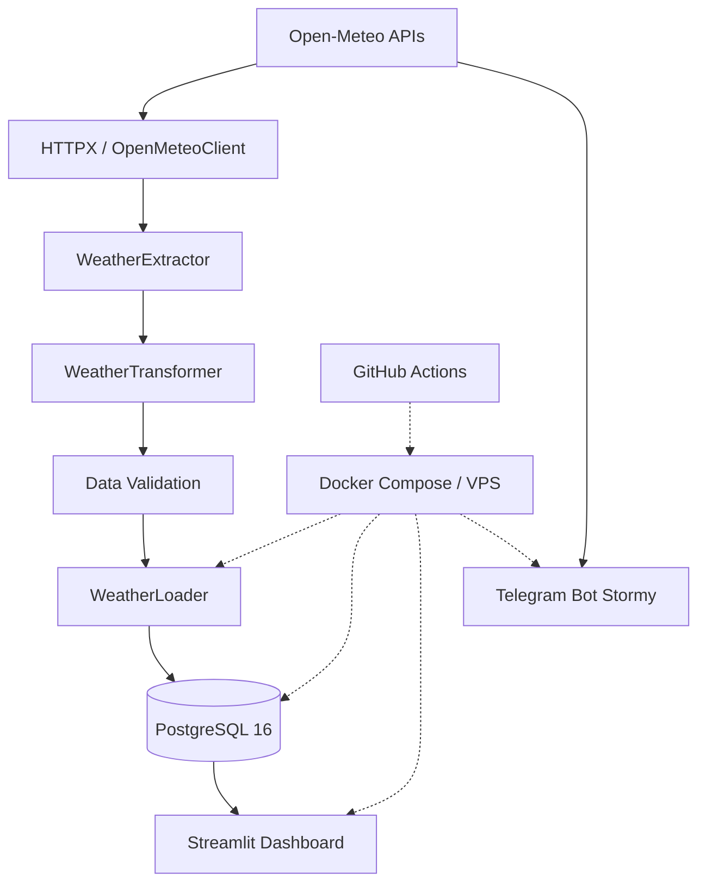

# Technical Design & Implementation

## Weather Analytics & Stormy

**Техническая архитектура и реализация аналитической платформы**

**Автор:** Марина Орленко  
**Репозиторий:** [weather-analytics](https://github.com/marinaorlenko/weather-analytics)  
**Дашборд:** [Weather Analytics Dashboard](https://stormy-analytics.ddns.net/)  
**Язык разработки:** Python 3.12  
**СУБД:** PostgreSQL 16

---

## 1. Назначение проекта

Weather Analytics & Stormy — система сбора, хранения, обработки и визуализации метеорологических данных для городов мира.

Проект объединяет несколько компонентов:

- ETL-процессы для загрузки исторических данных и прогнозов Open-Meteo;
- PostgreSQL для хранения погодных показателей и служебной информации;
- интерактивный аналитический дашборд Streamlit;
- Telegram-бот Stormy для получения погодной информации;
- контейнерную инфраструктуру Docker Compose;
- автоматизированное тестирование и развёртывание через GitHub Actions.

Система поддерживает накопление исторических данных, периодическое обновление прогнозов и анализ погодных показателей за разные временные интервалы.

### 1.1. Основные инженерные задачи

При разработке решаются следующие задачи:

1. Интеграция нескольких API Open-Meteo с различными структурами ответов.
2. Нормализация метеорологических данных для единой реляционной модели.
3. Загрузка больших исторических периодов с возможностью продолжения после прерывания.
4. Предотвращение дублирования записей при повторных запусках ETL.
5. Сохранение согласованных версий прогнозов из нескольких источников.
6. Обработка временных зон и различий между локальными календарными датами и UTC.
7. Организация аналитического доступа к данным через веб-интерфейс и Telegram.
8. Автоматизация тестирования, сборки и развёртывания приложения.

## 2. Технологический стек

| Технология | Применение в проекте |
|---|---|
| Python 3.12 | ETL, API-клиенты, бизнес-логика, аналитика и Telegram-бот |
| HTTPX | HTTP-запросы к Open-Meteo, обработка ошибок и повторные попытки |
| Pydantic / pydantic-settings | Типизированная конфигурация и проверка настроек |
| PostgreSQL 16 | Реляционное хранилище метеорологических данных |
| psycopg 3 | Выполнение SQL-запросов и управление транзакциями |
| SQLAlchemy | ORM-модели и создание структуры тестовой базы |
| Alembic | Инструментарий управления миграциями схемы |
| pandas | Преобразование, агрегация и подготовка аналитических данных |
| Streamlit | Веб-интерфейс аналитического дашборда |
| Altair | Интерактивные графики |
| python-telegram-bot | Telegram-интерфейс и обработчики сообщений |
| Docker / Docker Compose | Контейнеризация и организация сервисов |
| GitHub Actions | CI/CD и развёртывание на VPS |
| pytest / pytest-mock | Модульные и интеграционные тесты |
| Ruff | Статический анализ и форматирование Python |
| mypy | Дополнительная локальная проверка типов |
| logging | Журналирование ETL и диагностика ошибок |

В проекте используются как высокоуровневые библиотеки для аналитики и пользовательских интерфейсов, так и низкоуровневая работа с SQL, HTTP и транзакциями.

Такое разделение позволяет сохранять контроль над процессами загрузки данных и одновременно использовать готовые инструменты для визуализации.

## 3. Архитектура системы

### 3.1. Общая схема




Система состоит из трёх основных функциональных уровней.

**Уровень получения и обработки данных.** API-клиенты обращаются к Open-Meteo. ETL извлекает ответы, преобразует их в унифицированные записи, проверяет и сохраняет в PostgreSQL.

**Уровень хранения.** PostgreSQL содержит исторические и прогнозные данные, справочник городов, журнал ETL и состояние загрузки.

**Уровень предоставления данных.**

Streamlit получает исторические и прогнозные данные из PostgreSQL и использует их для аналитических расчётов и визуализации.

Telegram-бот Stormy работает независимо от хранилища метеорологических данных. Он обращается непосредственно к Open-Meteo API, обрабатывает полученные ответы и предоставляет пользователю актуальную погодную информацию.


### 3.2. Разделение ответственности

| Компонент | Основная ответственность |
|---|---|
| `api/client.py` | HTTP-транспорт, повторные попытки, ограничение частоты |
| `api/weather.py` | Запросы погодных данных |
| `api/geocoding.py` | Географический поиск |
| `etl/extractor.py` | Получение наборов исторических и прогнозных данных |
| `etl/transformer.py` | Преобразование ответов API |
| `etl/validator.py` | Проверка полноты исторических периодов |
| `etl/pipeline.py` | Оркестрация загрузки |
| `etl/loader.py` | Составные операции сохранения |
| `etl/loader_weather.py` | Репозиторий погодных данных |
| `etl/loader_runs.py` | Учёт запусков и состояния ETL |
| `etl/loader_queries.py` | Формирование и выполнение UPSERT |
| `db/models.py` | SQLAlchemy-модели |
| `dashboard/` | Аналитические запросы, расчёты и визуализация |
| `bot/` | Обработка пользовательских запросов Telegram |

Архитектура использует композицию классов и разделение операций извлечения, преобразования, проверки и сохранения.

Это позволяет тестировать отдельные компоненты независимо от полного ETL-процесса.

## 4. Конфигурация приложения

Конфигурация реализована через `pydantic-settings`.

**Файл:** `src/weather_analytics/config.py`

```python
class Settings(BaseSettings):
    """Хранит и проверяет настройки приложения и ETL."""

    model_config = SettingsConfigDict(
        env_file='.env',
        env_file_encoding='utf-8',
        extra='ignore',
    )

    app_env: Literal['local', 'server'] = 'local'

    db_host: str = 'localhost'
    db_port: int = Field(default=5432, ge=1, le=65535)
    db_user: str = 'postgres'
    db_password: str = Field(repr=False)
    db_name: str = 'weather_analytics'

    http_timeout: float = Field(default=15.0, gt=0)
    etl_request_delay: float = Field(default=2.0, ge=0)
```

*Фрагмент исходного класса `Settings`; остальные поля опущены.*

### 4.1. Принципы конфигурации

- Настройки загружаются из переменных окружения и `.env`.
- Pydantic проверяет типы и ограничения значений.
- Конфигурация поддерживает локальную и серверную среды.
- `get_settings()` использует `lru_cache`, исключая повторное создание объекта настроек при каждом обращении.
- Пароль PostgreSQL исключён из строкового представления модели.
- Токен Telegram хранится с использованием `SecretStr`.

### 4.2. Разделение сред

В `main.py` предусмотрены ограничения:

- `local` разрешён только при `APP_ENV=local`;
- `initial`, `daily`, `forecast` и `batch` разрешены при `APP_ENV=server`.

Значение `APP_ENV` по умолчанию — `local`. Docker Compose устанавливает `APP_ENV=server` для серверных Python-сервисов.

Такое разделение снижает риск случайного запуска масштабной исторической загрузки из локальной среды.

## 5. Интеграция с Open-Meteo

### 5.1. Используемые API

| API | Назначение |
|---|---|
| Geocoding API | Поиск городов и получение географических параметров |
| Historical Weather API | Суточные и почасовые исторические данные |
| Forecast API | Основной прогноз погоды |
| ECMWF API | Дополнительные специализированные прогнозные показатели |

Единый публичный интерфейс реализован классом `OpenMeteoClient`, который объединяет HTTP-транспорт, геокодирование и погодные запросы.

### 5.2. HTTP-транспорт

**Файл:** `src/weather_analytics/api/client.py`

Класс `OpenMeteoHTTPClient` использует `httpx.Client` и поддерживает:

- настраиваемый таймаут;
- повторные попытки при временных HTTP-ошибках;
- обработку сетевых ошибок и таймаутов;
- экспоненциальную задержку;
- обработку заголовка `Retry-After`;
- ограничение частоты исторических запросов;
- закрытие соединений через контекстный менеджер.

### 5.3. Повторные попытки

Фрагмент вычисления задержки:

```python
delay = min(
    HTTP_RETRY_BASE_DELAY * HTTP_RETRY_BACKOFF_FACTOR**attempt,
    HTTP_RETRY_MAX_DELAY,
)

if response is None:
    return delay

retry_after = response.headers.get('Retry-After')
```

**Инженерное решение:** экспоненциальная задержка уменьшает интенсивность повторных запросов при временной недоступности API.

Если сервер передаёт `Retry-After`, клиент учитывает его при расчёте ожидания с ограничением максимальной задержки.

Поддерживаются числовое значение задержки и HTTP-дата.

### 5.4. Ограничение частоты запросов

В проекте реализован `RequestRateLimiter`.

```python
class RequestRateLimiter:
    """Ограничивает частоту последовательных HTTP-запросов."""

    def __init__(self, interval: float) -> None:
        self._interval = interval
        self._lock = Lock()
        self._next_request = HTTP_RATE_LIMIT_INITIAL_TIME

    def wait(self) -> None:
        if self._interval <= 0:
            return

        with self._lock:
            remaining = self._next_request - time.monotonic()

            if remaining > 0:
                time.sleep(remaining)

            self._next_request = time.monotonic() + self._interval
```

**Файл:** `src/weather_analytics/api/client.py`

Реализация использует:

- `time.monotonic()` для измерения интервалов;
- `threading.Lock` для синхронизации обращений;
- общее состояние времени следующего разрешённого запроса.

В `WeatherETL.run()` создаётся один ограничитель для всего исторического запуска. Он передаётся клиентам при обработке разных городов и месяцев.

По умолчанию интервал составляет две секунды.

**Граница реализации:** ограничение применяется к запросам Historical Weather API. Это локальное ограничение частоты, а не полноценный счётчик всех квот Open-Meteo за минуту, час, день и месяц.

### 5.5. Обработка HTTP 429

В историческом ETL отдельно обрабатывается статус `429 Too Many Requests`.

После исчерпания предусмотренных повторных попыток ошибка передаётся в оркестратор, который останавливает историческую загрузку.

Это предотвращает продолжение массовых запросов к API после достижения ограничения.

## 6. ETL: извлечение, преобразование и загрузка

### 6.1. Режимы выполнения

**Точка входа:** `main.py`

| Режим | Назначение |
|---|---|
| `local` | Ограниченная историческая и прогнозная загрузка для разработки |
| `initial` | Историческая загрузка с заданной начальной даты |
| `daily` | Продолжение и обновление исторических данных |
| `forecast` | Загрузка основного прогноза и ECMWF |
| `batch` | Ограниченная загрузка выбранного диапазона, городов и числа периодов |

Запуск:

```bash
python main.py --mode local
```

Серверные режимы выполняются при `APP_ENV=server`.

Для `batch` предусмотрены аргументы:

```bash
python main.py \
  --mode batch \
  --start-date 2024-01-01 \
  --end-date 2024-12-31 \
  --cities Dubai Moscow \
  --max-periods 6
```

Здесь `--max-periods` ограничивает суммарное число успешно сохранённых месячных периодов за запуск, а не число городов.

### 6.2. Оркестрация

**Файл:** `src/weather_analytics/etl/pipeline.py`

Класс `WeatherETL` координирует:

1. Проверку режима и аргументов.
2. Инициализацию PostgreSQL.
3. Чтение справочника городов.
4. Выбор городов для обработки.
5. Создание общего ограничителя исторических HTTP-запросов.
6. Извлечение и преобразование данных.
7. Проверку исторических периодов.
8. Транзакционное сохранение.
9. Учёт успешных периодов и ошибок.

Список городов для ETL читается из `data/stormy_cities.csv`.

### 6.3. Загрузка истории по календарным месяцам

**Файл:** `src/weather_analytics/etl/date_utils.py`

Исторический диапазон разбивается на календарные месяцы.

Фрагмент:

```python
last_day = monthrange(
    current_date.year,
    current_date.month,
)[1]

month_end = date(
    current_date.year,
    current_date.month,
    last_day,
)

period_end = min(month_end, end_date)
periods.append((current_date, period_end))

current_date = period_end + timedelta(days=1)
```

Такой подход позволяет:

- обрабатывать длинную историю небольшими периодами;
- сохранять прогресс после каждого месяца;
- ограничивать объём одного запуска;
- повторять неуспешные периоды без повторной загрузки всей истории.

### 6.4. Возобновление исторической загрузки

Перед запросом данных ETL получает последнюю успешно сохранённую дату из `etl_state`.

```python
last_loaded_date = loader.get_last_loaded_date(city_id)

if last_loaded_date is not None:
    start_date = max(
        start_date,
        last_loaded_date + timedelta(days=1),
    )
```

**Файл:** `src/weather_analytics/etl/pipeline.py`

Если часть исторического диапазона уже загружена, процесс продолжает работу со следующей даты.

Важная особенность: прогресс обновляется в одной транзакции с погодными данными. Поэтому отметка о завершённом периоде не должна сохраняться отдельно от соответствующих записей.

### 6.5. Проверка полноты исторических данных

**Файл:** `src/weather_analytics/etl/validator.py`

Перед записью выполняется `validate_historical_records()`.

Проверяются:

- корректность диапазона дат;
- наличие всех ожидаемых суточных дат;
- количество почасовых записей;
- наличие временной зоны UTC;
- отсутствие пропусков и дубликатов во временной последовательности.

Пример:

```python
expected_days = (end_date - start_date).days + 1

expected_dates = {
    start_date + timedelta(days=offset) for offset in range(expected_days)
}

actual_dates = [record.get('weather_date') for record in daily_records]

if len(actual_dates) != expected_days or set(actual_dates) != expected_dates:
    raise ValueError('Неполные или некорректные суточные данные')
```

Для почасовой истории текущая реализация ожидает 24 записи на календарный день.

Это правило соответствует принятому формату исторической выгрузки в проекте. При изменении формата временных отметок API соответствующая проверка потребует пересмотра.

### 6.6. Преобразование данных

**Файл:** `src/weather_analytics/etl/transformer.py`

`WeatherTransformer` преобразует структуры ответов API в записи, соответствующие столбцам PostgreSQL.

Соответствия полей вынесены в `etl/field_mappings.py`.

Примеры:

| Поле Open-Meteo | Поле PostgreSQL |
|---|---|
| `temperature_2m_mean` | `temperature_mean` |
| `temperature_2m` | `temperature` |
| `wind_speed_10m_max` | `wind_speed_max` |
| `relative_humidity_2m` | `humidity` |
| `weather_code` | `weather_code` |

При преобразовании обрабатываются временные отметки, логические признаки и отсутствующие необязательные показатели.

Для исторических почасовых записей Unix timestamp преобразуется в `datetime` с UTC.

Отсутствующие необязательные значения передаются в PostgreSQL как `NULL`, а не заменяются произвольными нулями.

## 7. PostgreSQL: модель хранения и транзакции

### 7.1. Структура базы

В проекте используются восемь таблиц:

| Группа | Таблицы |
|---|---|
| Справочник | `cities` |
| Исторические данные | `historical_daily`, `historical_hourly` |
| Прогнозы | `forecast_daily`, `forecast_hourly`, `forecast_ecmwf_hourly` |
| Управление ETL | `etl_runs`, `etl_state` |

Полное описание столбцов, типов, единиц измерения и индексов приведено в [Data Dictionary](data_dictionary.md).

### 7.2. Составные первичные ключи

Для исторических данных используются ключи:

```sql
PRIMARY KEY (city_id, weather_date)
```

```sql
PRIMARY KEY (city_id, weather_time)
```

Для прогнозов ключ дополнен временем получения:

```sql
PRIMARY KEY (city_id, forecast_time, fetched_at)
```

Это позволяет сохранять несколько версий прогноза для одного города и прогнозируемого часа.

### 7.3. Идемпотентность через UPSERT

**Файл:** `src/weather_analytics/etl/loader_queries.py`

Для сохранения используется PostgreSQL `INSERT ... ON CONFLICT DO UPDATE`.

В проекте SQL формируется программно через `psycopg.sql`.

Фрагмент:

```python
return sql.SQL(
    'INSERT INTO {table} ({columns}) '
    'VALUES ({values}) '
    'ON CONFLICT ({conflict}) '
    'DO UPDATE SET {updates}'
).format(
    table=sql.Identifier(table),
    columns=sql.SQL(', ').join(sql.Identifier(column) for column in insert_columns),
    values=sql.SQL(', ').join(sql.Placeholder(column) for column in insert_columns),
    conflict=sql.SQL(', ').join(sql.Identifier(column) for column in conflict_columns),
    updates=sql.SQL(', ').join(
        sql.SQL('{} = EXCLUDED.{}').format(
            sql.Identifier(column),
            sql.Identifier(column),
        )
        for column in update_columns
    ),
)
```

**Инженерная ценность решения:**

- повторная запись с тем же ключом обновляет существующую строку;
- первичные ключи предотвращают появление дубликатов;
- имена таблиц и столбцов формируются через `sql.Identifier`;
- значения передаются через параметры;
- одна функция обслуживает несколько погодных таблиц.

Идемпотентность относится к состоянию записей с одинаковыми ключами. Она не означает, что повторный ETL никогда не создаёт новых служебных записей или новых версий прогнозов.

### 7.4. Пакетное сохранение

Функция `execute_batch()` использует:

```python
cursor.executemany(query, params)
```

Подготовка параметров выполняется отдельно в `prepare_records()`.

Это отделяет формирование SQL от набора передаваемых значений и позволяет использовать одну реализацию для исторических и прогнозных таблиц.

### 7.5. Атомарное сохранение исторического периода

**Файл:** `src/weather_analytics/etl/loader.py`

Метод `save_historical_period()` сохраняет в одной транзакции:

1. Суточные исторические записи.
2. Почасовые исторические записи.
3. Новую дату прогресса в `etl_state`.
4. Статус успешного выполнения в `etl_runs`.

Транзакция открывается через:

```python
with psycopg.connect(**self.connection_params) as connection:
    with connection.cursor() as cursor:
        ...
```

При возникновении исключения изменения внутри транзакции откатываются.

**Почему это важно:** если запись почасовой истории завершится ошибкой, дата успешной загрузки не должна продвинуться вперёд.

Иначе следующий запуск мог бы пропустить незагруженные данные.

### 7.6. Атомарное сохранение прогнозного снимка

Метод `save_forecast_snapshot()` сохраняет три набора данных:

- `forecast_daily`;
- `forecast_hourly`;
- `forecast_ecmwf_hourly`.

Все три набора получают единое значение `fetched_at` и идентификатор `forecast_run_id`.

В той же транзакции обновляется статус запуска ETL.

Это предотвращает частичное сохранение прогнозного снимка, при котором один источник был бы обновлён, а другой — нет.

## 8. Работа с временными зонами

Корректная обработка времени важна для международного набора городов.

Проект различает:

- локальные календарные даты города;
- UTC-время почасовых показателей;
- время получения прогнозной версии;
- время выполнения ETL.

### 8.1. Границы календарных дат

**Файл:** `src/weather_analytics/dashboard/data.py`

```python
start_local = pd.Timestamp(start_date).tz_localize(timezone)

end_local = (pd.Timestamp(end_date) + pd.Timedelta(days=1)).tz_localize(timezone)

return (
    start_local.tz_convert('UTC'),
    end_local.tz_convert('UTC'),
)
```

Функция `get_utc_date_bounds()` сначала определяет границы местных календарных суток, а затем переводит их в UTC.

Прибавление календарного дня до локализации позволяет учитывать изменения смещения часового пояса при переходах на летнее и зимнее время.

Это особенно важно для выборок, где пользователь задаёт даты в местном времени города, а PostgreSQL хранит почасовые отметки как `TIMESTAMPTZ`.

## 9. Аналитический дашборд Streamlit

### 9.1. Архитектура

Дашборд разделён на три основных аналитических направления:

**History** — исследование исторических погодных данных.

**Forecast** — анализ сохранённых прогнозов.

**Comparison** — сравнение погодных показателей городов.

Основные модули:

| Модуль | Назначение |
|---|---|
| `dashboard/data.py` | SQL-запросы и загрузка данных |
| `dashboard/history.py` | Историческая аналитика |
| `dashboard/forecast.py` | Прогнозная аналитика |
| `dashboard/forecast_data.py` | Подготовка прогнозных данных |
| `dashboard/comparison.py` | Сравнение городов |
| `dashboard/charts.py` | Визуализации Altair |
| `dashboard/weather_ui.py` | Форматирование и отображение показателей |

### 9.2. SQL как основа аналитического доступа

Данные извлекаются из PostgreSQL параметризованными SQL-запросами.

Например, загрузка суточной истории использует фильтрацию по `city_id` и сортировку по дате.

```sql
SELECT
    weather_date,
    temperature_min,
    temperature_max,
    precipitation,
    wind_speed_max,
    wind_direction_dominant,
    sunrise,
    sunset
FROM historical_daily
WHERE city_id = %s
ORDER BY weather_date
```

**Источник:** `dashboard/data.py`.

Такой подход позволяет явно контролировать состав полей, фильтрацию и порядок записей.

### 9.3. Выбор актуальной версии прогноза

Прогнозы хранятся с историей версий. Для отображения актуального суточного прогноза используется максимальное значение `fetched_at` для выбранного города.

```sql
SELECT
    forecast_date,
    temperature_min,
    temperature_max,
    precipitation,
    wind_speed_max,
    fetched_at
FROM forecast_daily
WHERE city_id = %s
  AND fetched_at = (
      SELECT MAX(fetched_at)
      FROM forecast_daily
      WHERE city_id = %s
  )
ORDER BY forecast_date
```

**Источник:** `dashboard/data.py`.

Это решение отделяет сохранение версий от логики отображения актуального прогноза.

### 9.4. Кэширование

Функции загрузки данных используют кэш Streamlit.

```python
@st.cache_data(ttl=300)
def load_cities() -> pd.DataFrame: ...
```

Аналогичный механизм применяется к загрузке погодных данных.

TTL составляет 300 секунд.

Кэширование уменьшает число повторных SQL-запросов при взаимодействии пользователя с интерфейсом.

При этом изменения в PostgreSQL могут отображаться с задержкой в пределах времени жизни кэша.

### 9.5. Аналитические расчёты

Для обработки данных используются pandas и SQL.

В историческом разделе реализована работа с разными временными диапазонами и агрегированными показателями.

В прогнозном и сравнительном разделах данные подготавливаются для визуализации в Altair.

Аналитический слой отделён от ETL: расчёты для графиков не изменяют исходные погодные записи в PostgreSQL.

### 9.6. Визуализация

Altair используется для построения интерактивных графиков.

Преимущества такого подхода:

- декларативное описание визуализаций;
- работа с pandas DataFrame;
- интерактивные подсказки;
- отдельное управление осями, легендами и цветами;
- повторное использование функций построения графиков.

Дашборд поддерживает русский и английский интерфейс.

## 10. Telegram-бот Stormy

### 10.1. Назначение

Stormy предоставляет погодную информацию через Telegram.

Бот поддерживает поиск населённых пунктов, обработку текстовых запросов, выбор языка и формирование погодных ответов.

### 10.2. Структура

| Модуль | Ответственность |
|---|---|
| `bot/telegram_bot.py` | Telegram-обработчики и пользовательские сценарии |
| `bot/parser.py` | Разбор текстовых погодных запросов |
| `bot/parser_patterns.py` | Шаблоны распознавания |
| `bot/city_search.py` | Поиск и выбор городов |
| `bot/geocoding.py` | Географическая логика |
| `bot/service.py` | Получение погодных данных |
| `bot/weather_calculations.py` | Погодные вычисления |
| `bot/weather_formatter.py` | Формирование ответов |
| `bot/messages.py` | Тексты интерфейса |
| `bot/constants.py` | Константы и ограничения |

### 10.3. Используемые механизмы

В Telegram-слое применяются:

- асинхронные обработчики;
- `CommandHandler`;
- `MessageHandler`;
- `CallbackQueryHandler`;
- inline-кнопки;
- сохранение пользовательского состояния через `PicklePersistence`;
- разбор свободного текста;
- локализация сообщений;
- обработка погодных кодов WMO.

Логика поиска, вычислений и форматирования вынесена из основного модуля Telegram-обработчиков.

Это уменьшает связанность пользовательского интерфейса с прикладной логикой.

### 10.4. Интерпретация погодных явлений

В коде используется классификация WMO-кодов.

Пример из `telegram_bot.py`:

```python
def classify_weather_code(code: int) -> str:
    """Определяет погодное явление по коду WMO Open-Meteo."""
    if code in (95, 96, 99):
        return 'thunderstorm'
    if code in (71, 73, 75, 77, 85, 86):
        return 'snow'
    if code in (51, 53, 55, 56, 57, 61, 63, 65, 66, 67, 80, 81, 82):
        return 'rain'
    if code in (0, 1):
        return 'sunny'
    return 'welcome'
```

Классификация применяется для выбора соответствующего погодного оформления, в том числе тематических стикеров Stormy.

## 11. Контейнеризация и инфраструктура

### 11.1. Docker Compose

**Файл:** `deploy/compose.yaml`

В инфраструктуре определены следующие сервисы:

| Сервис | Назначение |
|---|---|
| `db` | PostgreSQL 16 |
| `db-init` | Инициализация схемы |
| `dashboard` | Streamlit |
| `bot` | Telegram-бот |
| `etl` | Загрузка данных |

Сервис ETL помещён в профиль `jobs` и не предназначен для постоянной работы.

### 11.2. Постоянное хранение

PostgreSQL использует именованный Docker volume:

```yaml
volumes:
  - postgres_data:/var/lib/postgresql/data
```

Это позволяет сохранять данные независимо от жизненного цикла контейнера.

Для ETL предусмотрено монтирование:

```yaml
volumes:
  - ../data/stormy_cities.csv:/app/data/stormy_cities.csv:ro
  - ../logs:/app/logs
```

Справочник городов доступен контейнеру только для чтения. Журналы сохраняются в каталоге хост-системы.

### 11.3. Проверка готовности PostgreSQL

Сервис базы данных имеет `healthcheck` на основе `pg_isready`.

Зависимые сервисы ожидают завершения инициализации базы.

Это позволяет разделить запуск PostgreSQL, подготовку схемы и старт приложений.

### 11.4. Сетевое взаимодействие

В Docker Compose определена внутренняя сеть `backend`.

PostgreSQL публикует порт только на `127.0.0.1` хост-системы.

Streamlit также привязан к `127.0.0.1:8501` на хосте.

Таким образом, Compose не публикует эти сервисы непосредственно на всех внешних сетевых интерфейсах.

Публичный адрес дашборда:

https://stormy-analytics.ddns.net/

Конфигурация внешнего HTTPS-прокси не входит в рассмотренный `compose.yaml`, поэтому конкретные настройки TLS и проксирования здесь не приводятся.

## 12. CI/CD

### 12.1. GitHub Actions

**Файл:** `.github/workflows/deploy.yml`

Workflow запускается:

- при push в ветку `main`;
- вручную через `workflow_dispatch`.

Содержит две последовательные задачи:

1. `ci`;
2. `deploy`.

Развёртывание зависит от успешного завершения CI.

### 12.2. Проверка качества

В CI используется Ubuntu 24.04 и Python 3.12.

Для интеграционных тестов поднимается PostgreSQL 16 как сервис GitHub Actions.

Основные команды:

```bash
ruff check .
ruff format --check .
pytest -q
```

Проверка mypy предусмотрена в инструментарии проекта, но **не включена в текущий CI workflow**.

### 12.3. Развёртывание на VPS

После успешных проверок GitHub Actions подключается к серверу по SSH.

Используются GitHub Secrets:

- `VPS_SSH_KEY`;
- `VPS_KNOWN_HOSTS`;
- `VPS_HOST`;
- `VPS_USER`.

На сервере выполняются:

- получение актуальной версии `main`;
- сборка образа ETL;
- обновление постоянно работающих сервисов;
- проверка состояния контейнеров.

Фрагмент:

```bash
docker compose --env-file .env \
  -f deploy/compose.yaml \
  build etl

docker compose --env-file .env \
  -f deploy/compose.yaml \
  up -d --build --remove-orphans db dashboard bot
```

**Важное архитектурное решение:** деплой приложения не запускает автоматически историческую или прогнозную загрузку.

Это разделяет обновление программного обеспечения и операции обработки данных.

### 12.4. Расписание ETL

ETL запускается как отдельное задание.

Docker Compose определяет сервис и команду по умолчанию, но не содержит собственного расписания.

Конкретное серверное расписание необходимо документировать по фактической конфигурации планировщика VPS отдельно от CI/CD.

## 13. Тестирование

### 13.1. Стратегия

В проекте используются модульные и интеграционные тесты на pytest.

Проверяются отдельные компоненты ETL и их взаимодействие.

В архиве представлены тесты для:

- API-клиента Open-Meteo;
- извлечения и преобразования данных;
- проверки полноты истории;
- разбиения временных диапазонов;
- чтения справочника городов;
- SQL-операций загрузчика;
- исторического ETL;
- оркестрации пайплайна;
- пользовательских погодных запросов.

### 13.2. Изолированная тестовая база PostgreSQL

**Файл:** `tests/conftest.py`

Интеграционные тесты используют отдельную базу:

`weather_analytics_test`

Жизненный цикл:

1. Проверка конфигурации рабочей БД.
2. Проверка отсутствия существующей тестовой базы.
3. Создание временной базы PostgreSQL.
4. Создание таблиц через SQLAlchemy-модели.
5. Выполнение тестов с очисткой данных между ними.
6. Закрытие соединений.
7. Удаление созданной тестовой базы.

Фрагмент создания:

```python
cursor.execute(sql.SQL('CREATE DATABASE {}').format(sql.Identifier(TEST_DATABASE)))
```

Структура таблиц формируется через:

```python
Base.metadata.create_all(engine)
```

### 13.3. Защита существующих данных

Если база `weather_analytics_test` уже существует, тестовая сессия прерывается.

Автоматическое удаление заранее существующей базы запрещено.

Это предотвращает случайную потерю данных при неправильной конфигурации.

### 13.4. Изоляция тестов

Перед интеграционными тестами таблицы очищаются через `TRUNCATE ... RESTART IDENTITY CASCADE`.

Это обеспечивает повторяемое начальное состояние.

Для запуска необходим работающий PostgreSQL и пользователь с правами на создание и удаление баз данных.

### 13.5. Запуск проверок

```bash
python -m pytest -q
```

```bash
ruff check .
ruff format --check .
```

Дополнительная проверка типизации:

```bash
python -m mypy .
```

Наличие команды mypy не означает, что все проверки типов уже проходят без ошибок. Текущее состояние типизации необходимо оценивать по результату отдельного запуска.

## 14. Логирование и контроль ETL

### 14.1. Централизованное логирование

**Файл:** `src/weather_analytics/logging_config.py`

Класс `StormyLogger` настраивает стандартный Python `logging`.

Параметры:

| Параметр | Значение |
|---|---|
| Уровень | `INFO` |
| Вывод | Консоль и файл |
| Каталог | `logs/` |
| Имя файла | `etl_YYYY-MM-DD.log` |
| Срок хранения | 14 дней |
| Формат | Время, уровень, модуль, сообщение |

Логирование инициализируется в `main.py` перед запуском ETL.

### 14.2. Очистка журналов

При инициализации логгера выполняется удаление устаревших файлов, соответствующих формату `etl_YYYY-MM-DD.log`.

Очистка не является отдельным постоянно работающим процессом.

### 14.3. Журнал запусков PostgreSQL

Таблица `etl_runs` содержит:

- тип процесса;
- время начала и завершения;
- статус;
- число переданных на сохранение строк;
- сообщение об ошибке.

Возможные статусы:

- `running`;
- `success`;
- `failed`.

### 14.4. Состояние загрузки

Таблица `etl_state` хранит последнюю успешно загруженную историческую дату для города.

Совместное использование `etl_runs` и `etl_state` позволяет разделить две задачи:

**Аудит выполнения** — что произошло при конкретном запуске.

**Продолжение загрузки** — с какой даты необходимо возобновить исторический ETL.

## 15. Надёжность и обработка ошибок

В проекте реализованы несколько взаимодополняющих механизмов.

| Риск | Реализованное решение |
|---|---|
| Временная недоступность API | HTTP retry с задержкой |
| Превышение частоты запросов | Rate limiter для исторического API, обработка HTTP 429 |
| Неполный исторический ответ | Проверка полноты до записи |
| Повторная загрузка | UPSERT по ключам PostgreSQL |
| Частичная запись исторического месяца | Одна транзакция для данных, прогресса и статуса |
| Частичная запись прогноза | Атомарное сохранение трёх прогнозных таблиц |
| Прерывание исторического ETL | Продолжение по `etl_state` |
| Ошибка отдельного города | Регистрация ошибки и продолжение обработки, кроме специально останавливаемого HTTP 429 |
| Ошибка при тестировании | Изолированная тестовая база |
| Неудачный CI | Деплой не выполняется |

Эти механизмы повышают устойчивость обработки данных, но не гарантируют абсолютную доступность внешнего API или отсутствие любых ошибок.

## 16. Безопасность

### 16.1. Конфиденциальные настройки

Пароли PostgreSQL и токен Telegram передаются через переменные окружения.

Локальный `.env` не должен включаться в Git.

Для SSH-деплоя используются GitHub Secrets.

### 16.2. SQL-запросы

В запросах используются параметры psycopg.

При динамическом формировании UPSERT имена SQL-объектов передаются через `sql.Identifier`, а значения — через `sql.Placeholder`.

Это отделяет SQL-синтаксис от передаваемых данных.

### 16.3. Сетевые ограничения

PostgreSQL и Streamlit в Docker Compose публикуются на loopback-интерфейсе сервера.

Внутреннее взаимодействие сервисов осуществляется через Docker-сеть.

### 16.4. Локальные данные

Каталог `logs/` исключён из репозитория.

Секреты, журналы и постоянные данные PostgreSQL не должны попадать в исходный код приложения.

## 17. Ограничения и направления развития

Текущая архитектура имеет ряд осознанных границ.

**Квоты Open-Meteo.** Реализовано ограничение частоты исторических запросов, но отсутствует единый механизм учёта всех API-вызовов по часовым, дневным и месячным квотам.

**Контроль качества.** Для исторической загрузки проверяются полнота дат и непрерывность временного ряда. Более широкая система проверки физических диапазонов и статистических аномалий может развиваться отдельно.

**Наблюдаемость.** Присутствуют файловые журналы и служебные таблицы ETL. Отдельная система метрик и оповещений не подтверждена рассмотренной конфигурацией.

**Типизация.** mypy доступен как инструмент разработки, но пока не является обязательной проверкой CI.

**Инфраструктура.** Конфигурация Docker Compose не включает описание внешнего HTTPS-прокси и серверного расписания ETL.

**Тестирование.** CI выполняет Ruff и pytest. Дополнительные проверки производительности, нагрузки и безопасности могут быть включены в дальнейшее развитие.

## 18. Ключевые инженерные решения

| Решение | Практическая ценность |
|---|---|
| Разделение Extract / Transform / Load | Модульность и независимое тестирование |
| Типизированная конфигурация Pydantic | Ранняя проверка ошибок настроек |
| HTTP retry и rate limiting | Контроль сетевых ошибок и нагрузки на API |
| Месячная историческая загрузка | Управляемая обработка длинных периодов |
| `etl_state` | Возобновление после прерывания |
| Проверка полноты исторических данных | Защита от сохранения неполных периодов |
| PostgreSQL UPSERT | Повторяемость загрузки без дублирования ключей |
| Атомарные транзакции | Согласованность погодных данных и состояния ETL |
| `fetched_at` и `forecast_run_id` | Версионирование и происхождение прогнозов |
| UTC и часовые пояса городов | Корректная международная временная аналитика |
| Streamlit caching | Снижение повторной нагрузки на PostgreSQL |
| Docker Compose | Воспроизводимая организация сервисов |
| GitHub Actions | Автоматические проверки перед развёртыванием |
| Временная PostgreSQL-база в pytest | Безопасная изоляция интеграционных тестов |
| `StormyLogger` и `etl_runs` | Диагностика и аудит процессов |

## 19. Итоги

Weather Analytics & Stormy реализует полный цикл работы с метеорологическими данными: от HTTP-запросов к внешним источникам до транзакционного хранения, аналитических расчётов и пользовательских интерфейсов.

Наиболее значимые технические решения связаны с надёжностью обработки данных: возобновляемой исторической загрузкой, проверкой полноты, идемпотентным сохранением и атомарными транзакциями PostgreSQL.

Проект также демонстрирует практическое применение Python, SQL, HTTP API, pandas, Streamlit, Telegram Bot API, Docker и GitHub Actions в единой системе.

---

## Связанная документация

- [README](../README.md) — описание проекта, установка и запуск.
- [Data Dictionary](data_dictionary.md) — структура PostgreSQL, поля и единицы измерения.
- [Open-Meteo Documentation](https://open-meteo.com/en/docs) — документация источника данных.
- [PostgreSQL 16](https://www.postgresql.org/docs/16/) — документация СУБД.

**Автор:** Марина Орленко  
**GitHub:** https://github.com/marinaorlenko  
**Проект:** https://github.com/marinaorlenko/weather-analytics
