# Аналитическая записка

## Анализ климатических изменений в Дубае (2016–2026)

**Проект:** weather-analytics / Stormy
**Год:** 2026

---

## 1. Постановка исследовательского вопроса

Дубай расположен в зоне жаркого пустынного климата, где температурный режим и осадки отличаются выраженной сезонностью. Для оценки изменений погодных условий недостаточно сравнить отдельные рекордные дни: необходимо изучить многолетнюю динамику, распределение экстремальных событий и статистическую устойчивость наблюдаемых тенденций.

**Цель исследования** — оценить изменения температуры, осадков и сопутствующих метеорологических характеристик Дубая за десять полных исследовательских лет, а также проверить, какие из выявленных закономерностей подтверждаются статистически.

**Основные вопросы**: меняется ли среднегодовая температура; наблюдаются ли тенденции в осадках; насколько часто возникают экстремальная жара и сильные дожди; связаны ли температура и осадки после учета сезонности; что можно заключить из сопоставления дождей с опубликованной статистикой засева облаков в ОАЭ.

## 2. Данные и методика исследования

Основой анализа стали метеорологические данные Дубая из проекта weather-analytics, полученные через Open-Meteo. Период наблюдения — **1 ноября 2016 года — 31 октября 2026 года**. Для сопоставимости использованы десять полных исследовательских лет: каждый начинается 1 ноября и заканчивается 31 октября следующего календарного года. Поэтому обозначение «2026 год» на большинстве годовых графиков относится к периоду ноябрь 2025 — октябрь 2026.

В исследовании рассмотрены средняя, минимальная и максимальная температура, осадки, относительная влажность и скорость ветра. Анализ включал описательные статистики, сезонные профили, межгодовые сравнения, температурные аномалии, экстремальные события, корреляции и проверки гипотез.

Для оценки монотонных тенденций использован **критерий Кендалла** (проверяет, наблюдается ли устойчивое повышение или снижение показателя с течением времени и является ли выявленная тенденция статистически значимой). Для определения величины температурного тренда применена **оценка Тейла — Сена** (рассчитывает устойчивую к выбросам скорость изменения температуры, например в °C за год).

Для исследования связи между месячными аномалиями температуры и осадков использован **перестановочный тест с сохранением группировки по годам** (проверяет, насколько наблюдаемая корреляция отличается от случайной, при этом учитывает годовую структуру данных).

Для сравнения температурных аномалий в дождливые и сухие дни применен **бутстреп с повторными выборками по годам** (позволяет оценить неопределенность разницы средних значений и построить доверительный интервал, учитывая зависимость наблюдений внутри одного года).

Полученные результаты интерпретируются как **статистические ассоциации, а не причинно-следственные эффекты** (наличие связи между показателями само по себе не доказывает, что изменение одного показателя вызывает изменение другого).

## 3. Климатический профиль и сезонность

За исследуемый период среднесуточная температура воздуха составила **28,08 °C**, средняя относительная влажность — **59,28%**, а среднее значение суточных максимумов скорости ветра — **22,07 км/ч**. Температурный режим отличается ярко выраженным годовым циклом: наиболее жаркие месяцы — июль и август, когда средняя температура составляет около 35 °C; наиболее прохладные — январь и февраль, со средней температурой около 20–21 °C.

Осадки преимущественно приходятся на прохладную часть года. По средним месячным суммам выделяется март, но его высокий показатель существенно зависит от отдельных сильных дождей, поэтому его нельзя трактовать как типичную интенсивность осадков каждого марта. Доля дождливых дней максимальна зимой и в начале весны, летом дожди практически отсутствуют.

Относительная влажность в среднем выше в зимние месяцы и ниже весной и летом. Ветер также имеет сезонную динамику. Эти сезонные различия необходимо учитывать при анализе взаимосвязей между метеорологическими показателями. Без учета сезонности можно получить искаженные результаты: например, связь между температурой и количеством осадков может объясняться не непосредственной зависимостью между ними, а тем, что оба показателя закономерно изменяются в течение года.

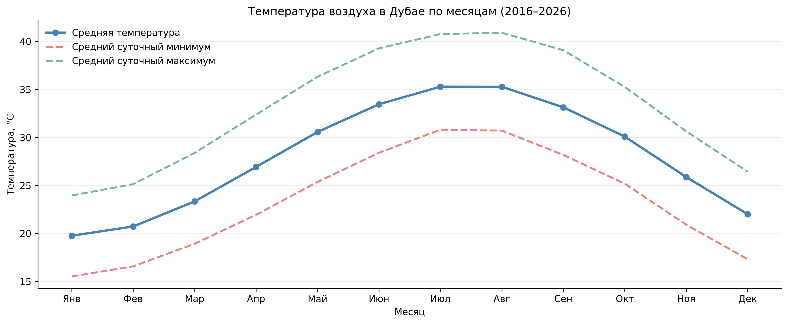

*Рисунок 1. Сезонная динамика среднемесячной температуры воздуха в Дубае..*

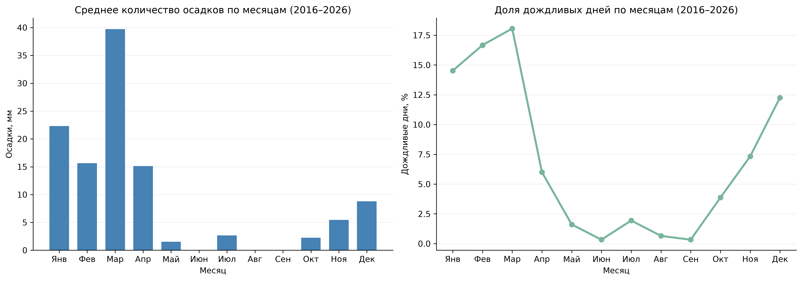

*Рисунок 2. Среднемесячные осадки и доля дождливых дней.*

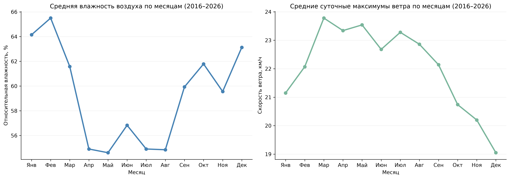

*Рисунок 3. Сезонная динамика влажности и ветра.*

## 4. Межгодовая динамика температуры и осадков

Среднегодовая температура исследовательских периодов находилась в диапазоне **27,55–28,62 °C**. Самым прохладным оказался период, завершившийся в 2020 году, самым теплым — в 2025 году. В последние годы температура в целом была выше, чем в начале наблюдений, однако описательной динамики недостаточно для статистического вывода о тренде.

Годовые суммы осадков менялись гораздо сильнее: от **6,7 мм** в периоде 2021 года до **325 мм** в периоде 2026 года. Значительные суммы также отмечены в 2020 и 2024 годах. Межгодовые различия во многом обусловлены небольшим числом сильных дождей, а не устойчивым увеличением количества дождливых дней.

Средняя влажность по годам оставалась в пределах **56,55–61,33%**. На графике скорости ветра заметно снижение в 2025–2026 годах до примерно 16–17 км/ч по сравнению с 23–24 км/ч в предыдущие годы. Такой резкий сдвиг заслуживает отдельной проверки однородности исходного показателя и источника данных; сам по себе он не доказывает климатического изменения ветрового режима.

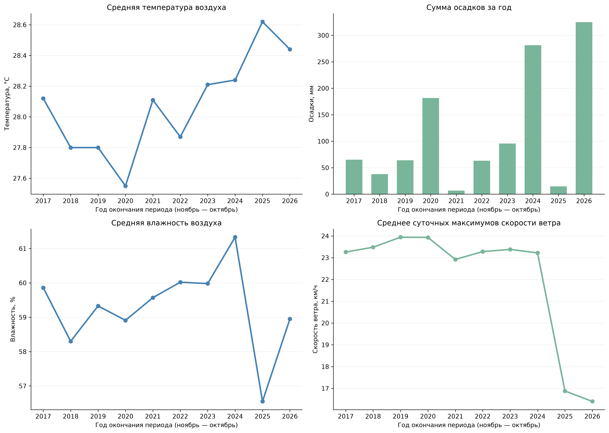

*Рисунок 4. Межгодовая динамика температуры, осадков, влажности и ветра.*

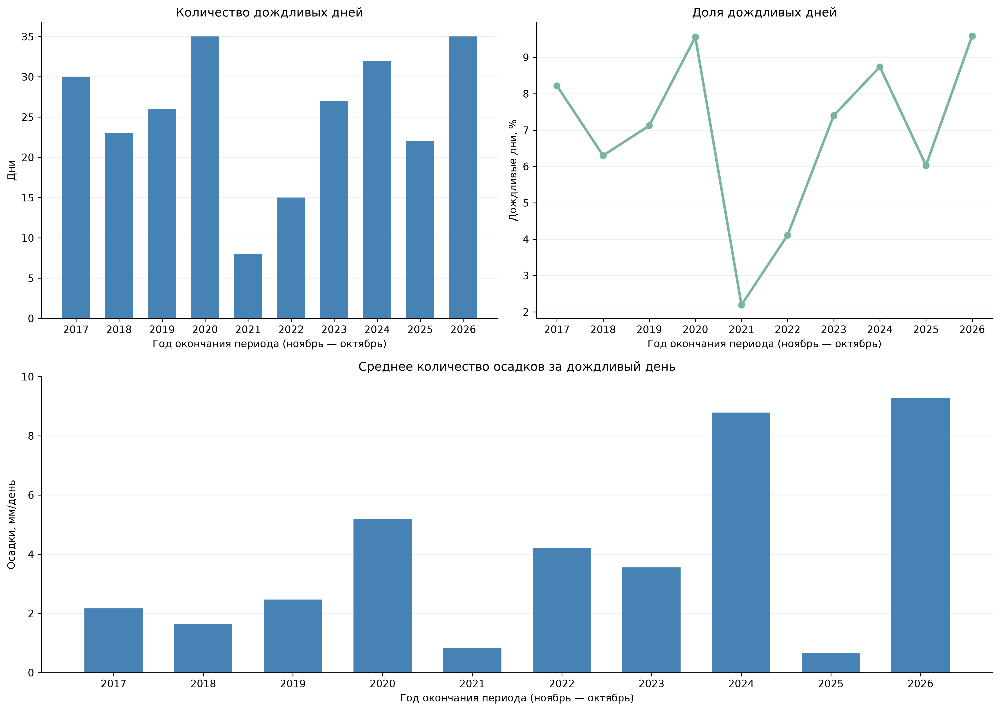

*Рисунок 5. Частота дождливых дней и интенсивность осадков по исследовательским годам.*

## 5. Экстремальные осадки и температурные аномалии

За десять лет зарегистрировано **253 дождливых дня**, или **6,93%** наблюдений. Медиана осадков среди дождливых дней составила **0,7 мм**, среднее — **4,49 мм**, а максимальная суточная сумма достигла **113 мм**. Такая асимметрия означает, что большинство дождей слабые, но отдельные экстремальные события резко увеличивают годовые суммы.

Максимум суточных осадков зарегистрирован **16 апреля 2024 года — 113 мм**. Следующие заметные события: **27 марта 2026 года — 108,2 мм** и **11 января 2020 года — 81,9 мм**. За 23–27 марта 2026 года суммарно выпало **258,6 мм**. В периодах 2024 и 2026 годов было по четыре дня с осадками от 20 мм, включая по два дня с осадками от 50 мм.

Температурные аномалии рассчитаны относительно среднего значения для соответствующего времени года. Наиболее отрицательная среднегодовая аномалия наблюдалась в 2020 году (**−0,51 °C**), наиболее положительная — в 2025 году (**+0,54 °C**). В 2023–2026 годах годовые аномалии были положительными.

В 2025 году зафиксировано **82 дня** с суточным максимумом температуры не ниже 40 °C, из них **9 дней** — не ниже 45 °C. При этом абсолютный максимум периода (**47,3 °C**) отмечен в 2018 году. В 2025 году насчитывалось **9 периодов жары** продолжительностью не менее пяти дней подряд, суммарно 62 дня; самый длинный отдельный период составил **24 дня** и пришелся на 2017 год. Это различие показывает, что частота экстремально жарких дней и продолжительность непрерывной жары — не одно и то же.

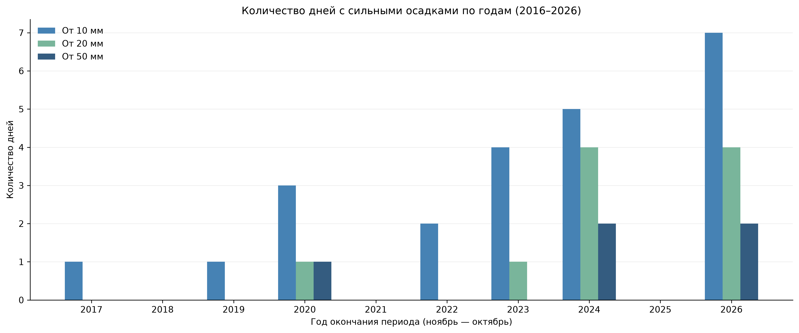

*Рисунок 6. Число дней с сильными осадками по годам.*

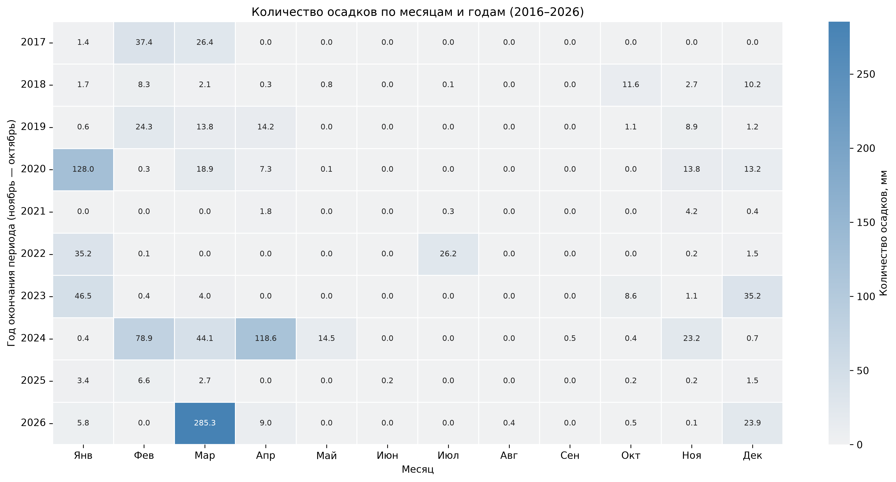

*Рисунок 7. Месячные суммы осадков: контраст между годами.*

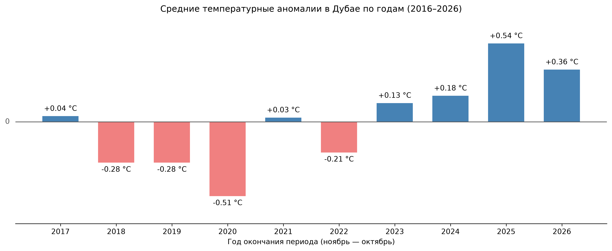

*Рисунок 8. Средние годовые температурные аномалии.*

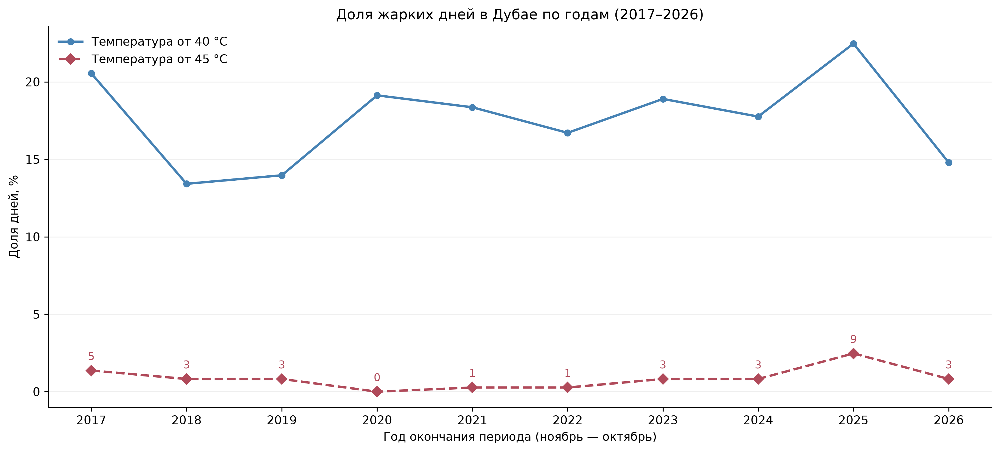

*Рисунок 9. Доля дней с экстремально высокой температурой.*

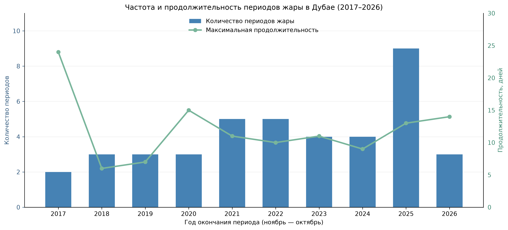

*Рисунок 10. Частота и длительность продолжительных периодов жары.*

## 6. Взаимосвязи погодных показателей

Наиболее выраженная из рассмотренных ежедневных связей обнаружена между температурой и относительной влажностью (**r = −0,44**): в более теплые относительно сезонной нормы дни влажность чаще была ниже. Корреляция температуры с суточными осадками оказалась слабой (**r ≈ −0,05**).

Для 61 изолированного дождливого дня средняя температурная аномалия после дождя снижалась и на вторые сутки достигала **−0,46 °C**. Но при расширении анализа до 89 дождливых событий снижение температуры отмечено в **48,31%**, повышение — в **49,44%** случаев; среднее изменение составило **−0,11 °C**, медиана — 0 °C. Следовательно, устойчивое похолодание после каждого дождя данными не подтверждается.

Слабые корреляции между осадками и температурой в день дождя и в следующие пять дней (примерно от −0,05 до −0,08) дополнительно показывают, что простой линейной зависимости недостаточно для описания погодных событий.

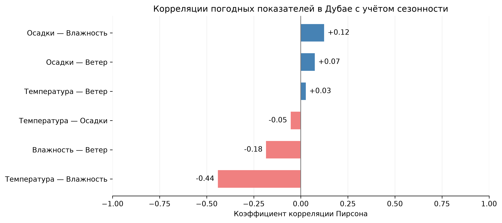

*Рисунок 11. Корреляции основных метеорологических показателей.*

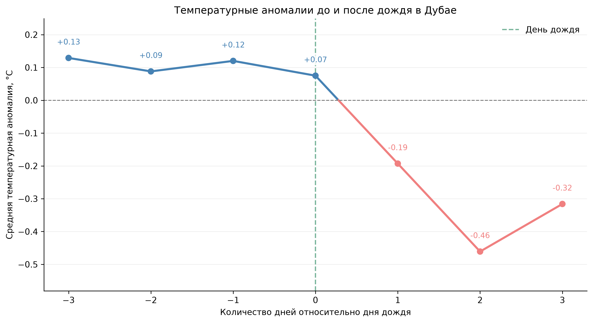

*Рисунок 12. Температурные аномалии вокруг дождливых дней.*

## 7. Статистическая проверка гипотез

Критерий Кендалла выявил **статистически значимый положительный тренд среднегодовой температуры**: **τ = 0,584**, **p = 0,0196**. Оценка Тейла — Сена составила **+0,08 °C в год**, с 95%-м доверительным интервалом приблизительно **от +0,017 до +0,148 °C в год**. В рамках десятилетнего ряда это свидетельствует о повышении температурного фона.

Для годовой суммы осадков и доли дождливых дней статистически значимых монотонных тенденций не выявлено. Это не означает отсутствия изменений вообще: высокая межгодовая изменчивость и короткий период наблюдений ограничивают способность тестов обнаруживать слабые эффекты.

Связь месячных аномалий температуры и осадков оказалась слабой (**r = −0,0943**). Перестановочный тест с учетом группировки по годам дал **p = 0,4636**: оснований утверждать наличие устойчивой линейной связи не получено.

Средняя разница температурных аномалий между дождливыми и сухими днями составила **+0,086 °C**, а 95%-й доверительный интервал при повторных выборках по годам — **от −0,120 до +0,276 °C**. Поскольку интервал включает ноль, статистически подтвержденного различия не обнаружено.

**Главный статистический результат:** из проверенных направленных изменений подтвержден рост среднегодовой температуры. Сопоставимых доказательств тренда осадков или устойчивой связи дождя с температурными аномалиями не получено.

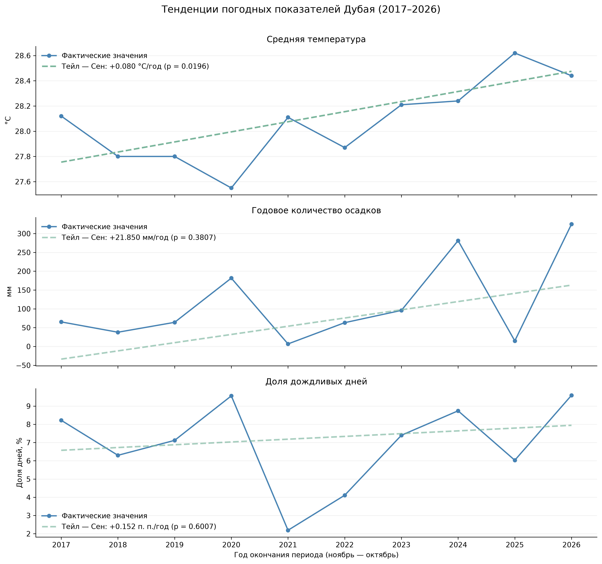

*Рисунок 13. Тренд температуры и оценка Тейла — Сена.*

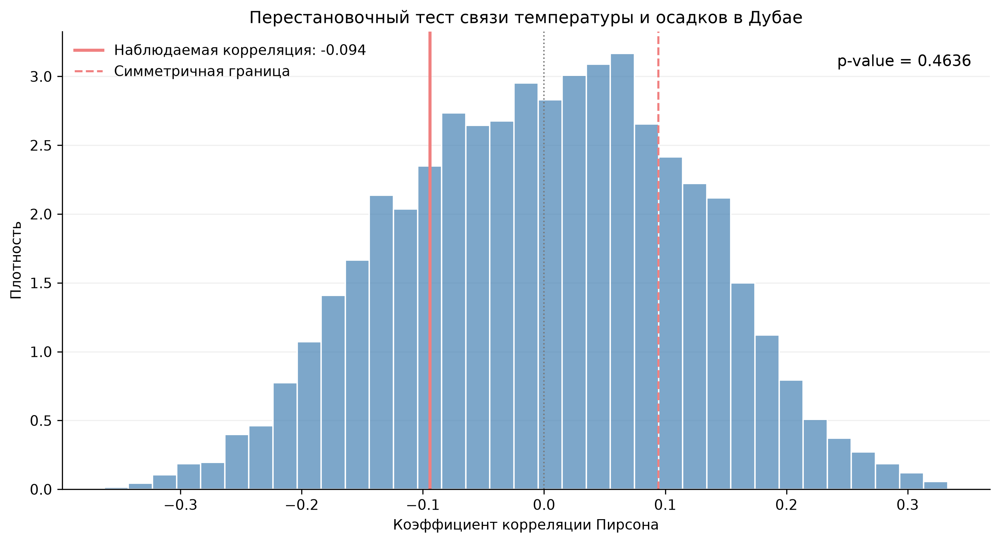

*Рисунок 14. Проверка связи месячных аномалий температуры и осадков.*

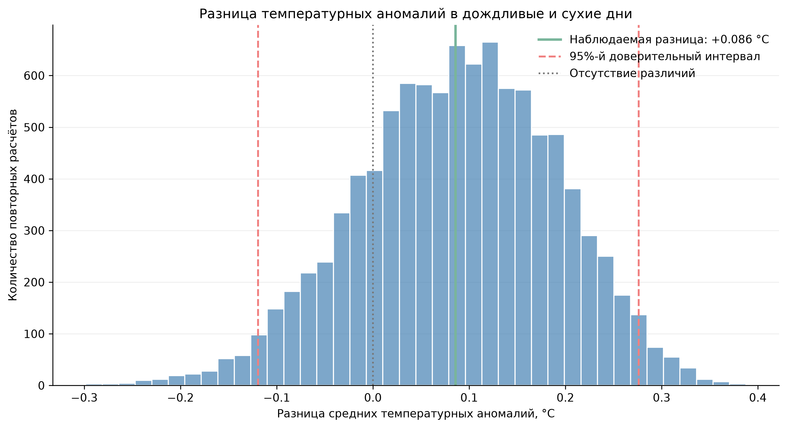

*Рисунок 15. Разница температурных аномалий между дождливыми и сухими днями и ее неопределенность.*

## 8. Засев облаков в ОАЭ: контекст и ограничения сопоставления

Программы увеличения осадков в ОАЭ развиваются с 1990-х годов. В 2015 году была создана UAE Research Program for Rain Enhancement Science (UAEREP), действующая под управлением Национального центра метеорологии ОАЭ (NCM). Исследовательские проекты посвящены технологиям засева облаков, формированию осадков, дистанционному зондированию и моделированию.

Для дополнительного анализа в ноутбуке собраны опубликованные сведения о количестве операций засева облаков в ОАЭ. Поскольку источники используют термины *operations*, *missions* и *flights*, сопоставимость единиц учета ограничена. Для сравнения с осадками использованы **календарные годы**, а не исследовательские периоды ноябрь–октябрь.

В ноутбуке сопоставлены **семь календарных лет: 2017–2022 и 2024**. Коэффициент Пирсона составил **r = 0,764; p = 0,0454**, коэффициент Спирмена — **ρ = 0,536; p = 0,2152**. Первый тест показывает положительную линейную ассоциацию, второй не подтверждает статистически значимой монотонной связи.

**Корреляция не доказывает эффективность засева облаков.** Операции учитывались по всей территории ОАЭ, а осадки — только в Дубае. Количество операций зависит от наличия подходящих облаков и погодных условий; отдельные дождливые годы способны сильно влиять на результат при семи наблюдениях. Кроме того, извлеченные из публикаций годовые показатели требуют проверки по первоисточникам и унификации терминологии до использования как окончательной официальной статистики.

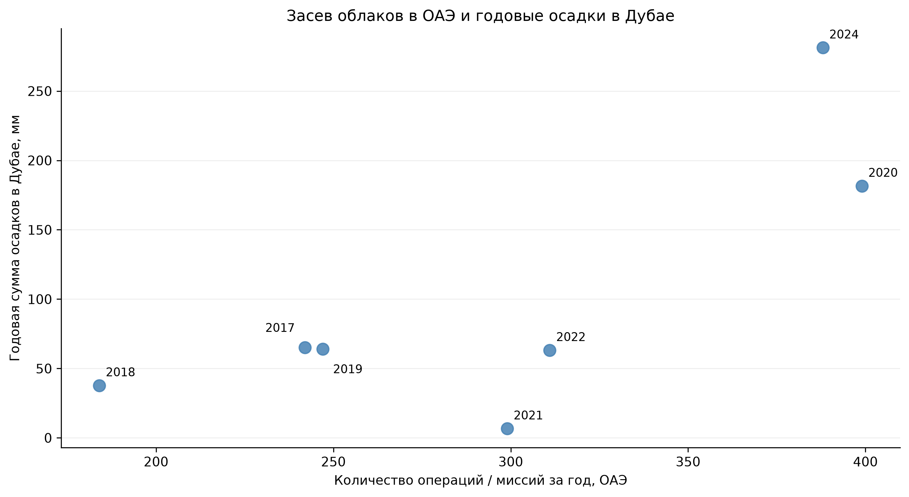

*Рисунок 16. Связь количества операций по засеву облаков в ОАЭ и годовой суммы осадков в Дубае (2017–2022, 2024 гг.).*

## 9. Ограничения исследования

**Длина ряда.** Десять лет достаточно для описания наблюдаемой динамики и отдельных статистических тестов, но недостаточно для надежной характеристики долгосрочного регионального изменения климата. Выявленный тренд следует трактовать в границах исследуемого периода.

**Источник и однородность данных.** Использованы данные Open-Meteo; оценки могут зависеть от модели, пространственного разрешения и методики формирования суточных показателей. Резкий сдвиг скорости ветра в 2025–2026 годах требует отдельной проверки согласованности исходного ряда.

**Редкость экстремальных событий.** Годовые суммы осадков чувствительны к нескольким сильным дождям. Корреляции и средние значения не раскрывают полностью механизмы таких событий.

**Наблюдательный дизайн.** Статистические связи между погодными показателями не устанавливают причинность. Для засева облаков дополнительно ограничивают выводы пространственное несовпадение данных, небольшой размер выборки и неоднозначность единиц учета.

## 10. Итоговые выводы

Исследование выявило устойчивую сезонную структуру погоды Дубая: продолжительный жаркий сезон, мягкую зиму и редкие, преимущественно зимне-весенние осадки. Большинство дождливых дней характеризуется небольшими суммами, но отдельные интенсивные события определяют значительную часть годовых различий.

**Основной подтвержденный результат — повышение среднегодовой температуры** в течение десяти исследовательских лет, примерно на **0,08 °C в год** по оценке Тейла — Сена. При этом статистически значимых тенденций годовых осадков и частоты дождливых дней не обнаружено.

Проверки связи температуры и осадков после учета сезонности не подтвердили устойчивой линейной зависимости. Сопоставление количества операций засева облаков в ОАЭ и осадков Дубая выявило положительную корреляцию Пирсона на небольшой выборке, но не дает оснований для причинного вывода.

Дальнейшее исследование целесообразно расширить более длинным однородным метеорологическим рядом, проверкой ветровых показателей и верифицированными данными об операциях засева с указанием времени и территории проведения.

## Источники и материалы

Основной источник числовых результатов — расчеты в `dubai_weather_analysis.ipynb`. Внешние ссылки приведены для описания происхождения метеоданных и контекста программы засева облаков.

- [Open-Meteo — Historical Weather API](https://open-meteo.com/en/docs/historical-weather-api)
- [UAEREP — About the Program](https://www.uaerep.ae/section/the-program/about-the-program?locale=en&nID=2094)
- [UAEREP — Research Projects](https://www.uaerep.ae/research-projects?locale=en)
- [WMO — A Decade Revolutionizing Rain Enhancement Science and Applications](https://wmo.int/resources/meteoworld/meteoworld-june-2025/decade-revolutionizing-rain-enhancement-science-and-applications)
